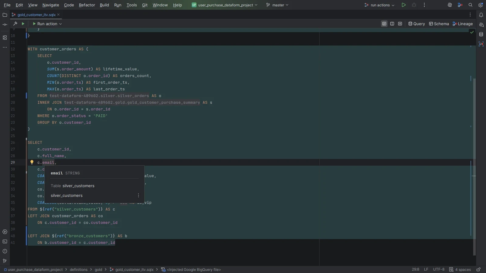
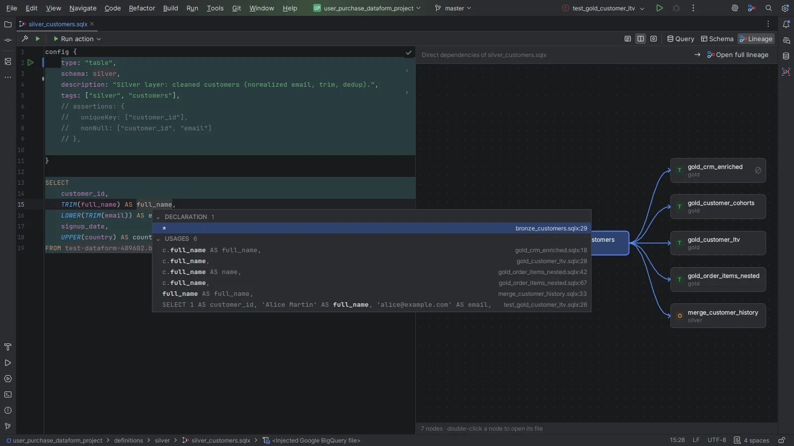
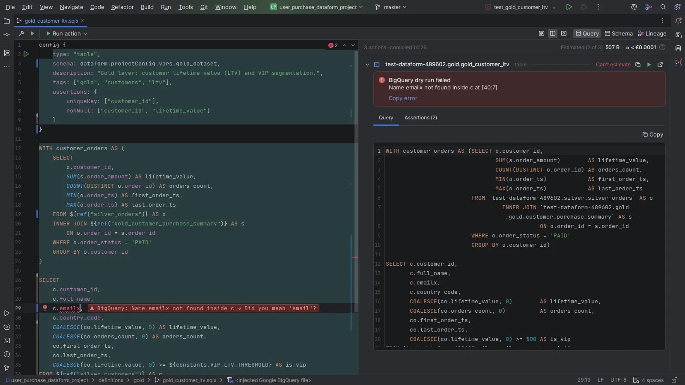
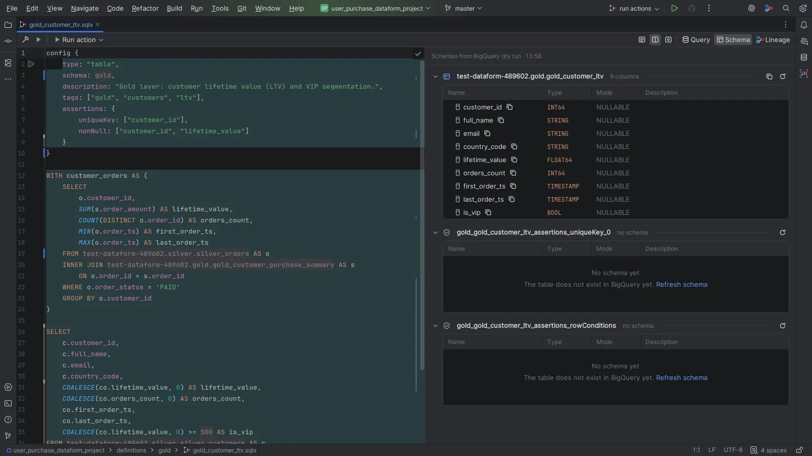
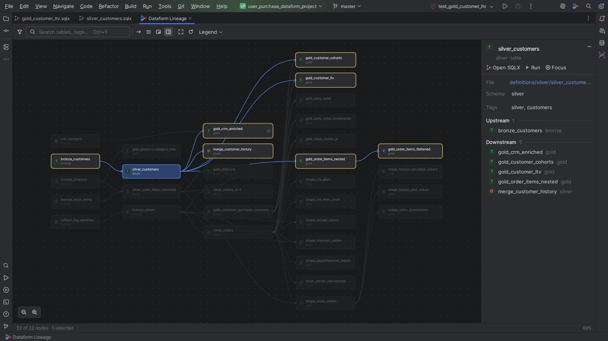
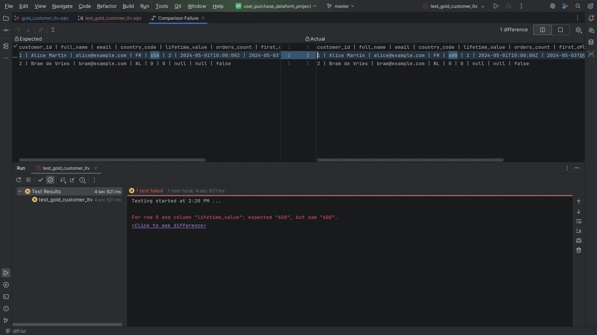
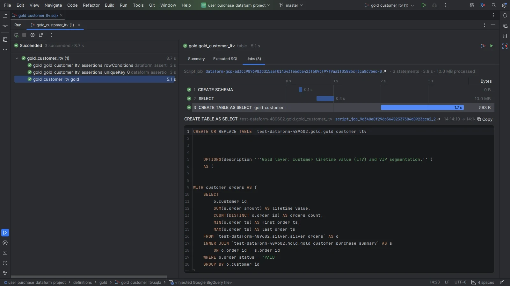
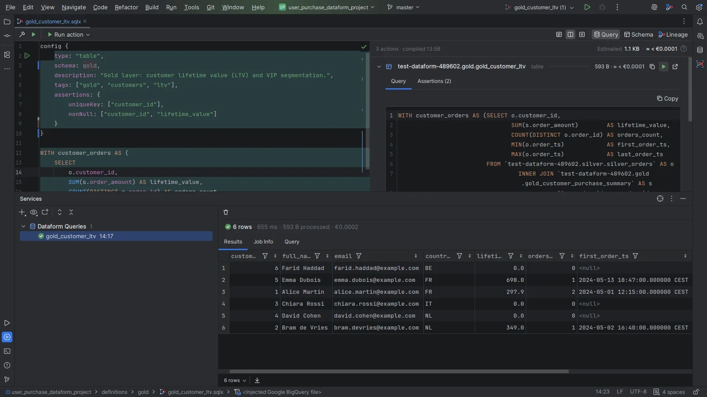
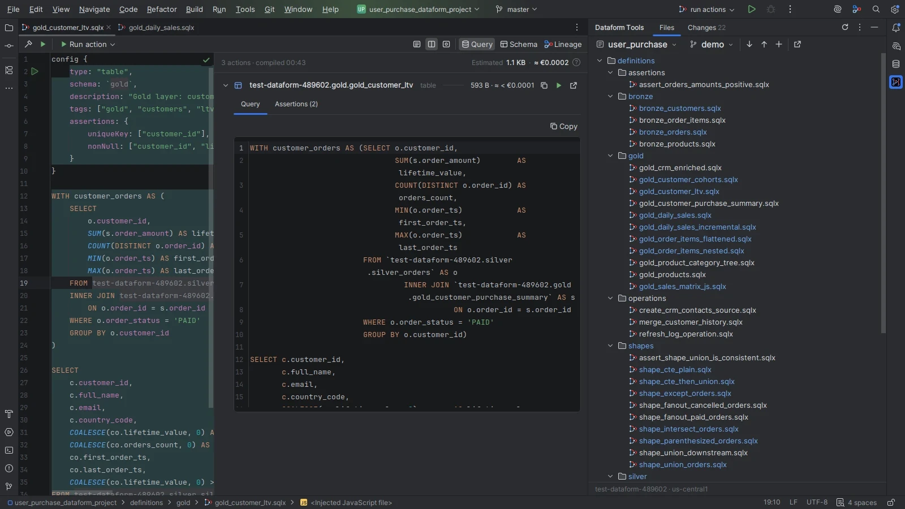

# Google Cloud Dataform Plugin for IntelliJ IDEA

A comprehensive IntelliJ IDEA plugin that provides advanced language support for Google Cloud Dataform projects, enabling developers to work efficiently with SQLX files and Dataform workflows.


[](https://www.java.com/fr/)
[](https://plugins.jetbrains.com/plugin/30020)
[](https://plugins.jetbrains.com/plugin/30020)

**[Documentation](https://rejeb.is-a.dev/dataform-plugin/docs)** · **[Features, with screenshots and videos](https://rejeb.is-a.dev/dataform-plugin/features)**

## Screenshots

<table>
  <tr>
    <td width="33%" align="center">
      <br>
      <sub><b>SQLX editing</b></sub>
    </td>
    <td width="33%" align="center">
      <br>
      <sub><b>Column usages</b></sub>
    </td>
    <td width="33%" align="center">
      <br>
      <sub><b>Errors in the editor</b></sub>
    </td>
  </tr>
  <tr>
    <td width="33%" align="center">
      <br>
      <sub><b>Compiled preview</b></sub>
    </td>
    <td width="33%" align="center">
      <br>
      <sub><b>Project lineage</b></sub>
    </td>
    <td width="33%" align="center">
      <br>
      <sub><b>Unit tests</b></sub>
    </td>
  </tr>
  <tr>
    <td width="33%" align="center">
      <br>
      <sub><b>Workflow runs</b></sub>
    </td>
    <td width="33%" align="center">
      <br>
      <sub><b>Query results</b></sub>
    </td>
    <td width="33%" align="center">
      <br>
      <sub><b>Dataform panel</b></sub>
    </td>
  </tr>
</table>

## Features

### SQLX Language Support
- **Syntax Highlighting**: Full syntax highlighting for SQLX files with support for SQL, JavaScript, and config blocks
- **Code Completion**: Intelligent code completion for:
  - Dataform built-in functions (`ref()`, `declare()`, `publish()`, etc.)
  - JavaScript symbols and TypeScript definitions
  - Workflow settings and configuration properties
  - JSON schema-based completion for configuration files
  - `ref()` completion listing the actions declared in the project, in SQLX and JavaScript files
  - Dataform template expressions (`${...}`), with the `$` key opening completion automatically
  - `config { }` properties, their enumerated values, and the tags already used in the project
  - Columns of the action in `config { }`: keys of the `columns` map, `clusterBy`, `uniqueKey`, the
    `assertions` block, and the partitioning expressions BigQuery accepts in `partitionBy`
- **Code Navigation**: Navigate between references, includes, and declarations
- **BigQuery SQL Support**: Native BigQuery SQL dialect integration with proper syntax validation
- **Declared Variables**: `DECLARE` variables defined in pre-operations resolve inside the query

### Quick Documentation
`Ctrl+Q` on:
- **Table References**: `ref()` and resolved tables show the target action, its type, schema and columns
- **Columns**: Column name, type, mode and description from the resolved table schema
- **BigQuery Functions**: Built-in documentation for the BigQuery function catalog, with signature,
  description and examples
- **Config Keys**: What a `config { }` key expects and, for column-naming keys, the columns the
  action actually produces

### Inline Expression Values
Dataform expressions are folded to their evaluated value in the editor, the way IntelliJ shows
`.properties` values instead of their key. Click a fold to expand it back to the source.
- **`${...}` in SQL and `pre/post_operations` blocks**, and in query template literals of `.js` /
  `.ts` definition files: `FROM ${ref("users")}` reads as `FROM my-project.my_dataset.users`
- **`workflow_settings.yaml` references** in `config { }` and `js { }` blocks:
  `dataform.projectConfig.vars.env` reads as its YAML value
- **`includes/` exports** used in `config { }` and `js { }` blocks, such as
  `columns: my_descriptions.columns_descriptions`, read as the exported value
- An expression whose value is long or multi-line is painted **over several lines**, in place,
  keeping the value's own formatting. Code sharing the line, such as `columns: ` and the trailing
  comma of a config property, is repainted around it. The gutter icon brings the source back
- Shorter values fold to a single line; `Ctrl+Q` on any expression shows the full value
- Only expressions with a single deterministic value are folded: the Dataform graph functions
  (`ref()`, `resolve()`, `self()`, `name()`, `schema()`, `database()`), workflow settings, and your
  own `includes/` code. Expressions depending on the run mode (`when()`, `incremental()`) or defining
  actions (`publish()`, `operate()`, `assert()`, `declare()`) stay visible — but the deterministic
  `${...}` nested inside them, at any depth, are still folded
- Values are computed by running the expression with the Node.js interpreter configured for the
  project, so `includes/` helper functions, string building and any other JavaScript resolve exactly
  as Dataform would evaluate them. `ref()` and `self()` use the last compiled graph, so they resolve
  after a build; nothing is folded when a value cannot be computed.
- Because project JavaScript is executed as you type, the feature can be turned off under
  **Settings ▸ Tools ▸ Dataform ▸ Fold Dataform expressions to their evaluated value**.

### Multi-Language Injection
- **SQL Injection**: BigQuery SQL support within SQLX SQL blocks with template expression handling
- **JavaScript Injection**: Full JavaScript/TypeScript support in JS blocks
- **Config Injection**: JSON-based configuration with schema validation
- **Template Injection**: Support for Dataform template expressions
- **JS Query Injection**: BigQuery SQL injected in query template literals written in `.js` / `.ts`
  files, with working `ref()` resolution and column completion

### Smart References
- **File References**: Navigate to included files and definitions
- **Symbol References**: Jump to function declarations and usages
- **Workflow Settings References**: Link to workflow configuration properties
- **Column Navigation**: `Ctrl+Click` on a column in a SQLX query opens a window with its declaration and
  every place that reads it

### Column Refactoring and Usages
- **Rename Downstream Usages**: After a column is renamed in its action and saved, the new name is
  highlighted while downstream actions still read the old one; its quick fix, also offered in a
  balloon, renames those reads through the rename preview
- **Rename Column** (`Shift+F6`): Renames a column of a Dataform table in the action declaring it and
  in every action reading it, following the column lineage, with `config { }` keys and unit tests
  included. When the column comes from a `SELECT *`,
  a dialog asks whether to expand the star or declare the new name locally
- **Find Usages**: Works on Dataform tables, columns, the aliases declaring them, and fields of
  `STRUCT` columns
- **Show Column Usages** (`Alt+Shift+U`, `Ctrl+Click` or the editor menu): A popup listing where
  the column under the caret is declared and every place that reads it

### Errors and Validation
- **In-Place Errors**: Dataform compilation errors and BigQuery dry-run errors are placed on the
  tokens they refer to, with inline chips in the editor
- **Column Impact Analysis**: On save, columns renamed, removed or retyped are compared with the
  actions reading them; the broken ones are listed per file in the Build tool window, and their
  errors in the editor name the change behind them
- **Build Tool Window**: Compilation errors with the code frame they point to and failing BigQuery
  dry-runs, grouped per file. A Dataform CLI that fails to start or stops before compiling is explained,
  with the command to reproduce it
- **Unplaced Errors Banner**: Errors that cannot be located in the file are listed in an editor banner
- **Validation**: Dataform validation problems are highlighted at their exact range, with hints and
  quick fixes, once typing stops
- **`partitionBy` Inspection**: Reports a `partitionBy` written as an object and replaces it with
  the BigQuery partitioning expression it stands for
- **`js { }` Symbols**: Functions and constants of a `js` block used from `${...}` are no longer
  reported as unused

### Dataform Unit Tests
- **Create Dataform Test**: Generates `definitions/tests/test_<action>.sqlx` for a table or view,
  from the project view or the editor menu
- **Test Editing**: Completion of the tested dataset, input names and column aliases, and
  `Ctrl+Click` from an alias to the column it stands for
- **Run Tests on BigQuery**: A `Dataform Unit Tests` run configuration with gutter icons; results
  appear in the IDE test runner, with expected and actual rows side by side on failure
- **Test View**: The compiled test query and expected output next to the test file, runnable in BigQuery

### Table Schemas and Column Completion
- **Schema Resolution**: Table schemas are resolved through BigQuery dry-runs of the compiled queries,
  for tables, views and operations declaring `hasOutput: true`
- **Column Completion**: Completion for columns of tables produced by your Dataform project, including
  qualified names and nested `STRUCT`/`RECORD` fields
- **Safe Introspection**: Only pre-operations known to have no side effects (`DECLARE`, `SET`, `SELECT`,
  `WITH` and temporary functions) are kept when a dry-run or a preview query is sent

### Compiled Preview Editor
A split editor next to any `.sqlx` file, with a toolbar to compile, run the query or run the action,
and these views:
- **Query**: The compilation time and estimated total, then one block per action with its compiled
  SQL (pre-operations, incremental pre-operations, the query, post-operations), its assertions in
  their own tab, resizable SQL blocks, and buttons to copy, run or open the query in the BigQuery console
- **Schema**: The output columns of each action as a tree, nested `STRUCT` fields included, with type,
  mode and description, and a button to copy a column's path
- **Lineage**: The dependency graph around the current file
- **Test**: For a unit test file, the compiled test query and expected output

### Lineage View
- **File Lineage**: Upstream and downstream dependencies of the open file
- **Project Lineage**: A full project graph (`Tools` → `Open Dataform Lineage`, or `Alt+Shift+D`)
- **Column-Level Lineage**: Expand a node to see its columns and follow column-to-column edges,
  derived from the compiled `SELECT` statements, with a confidence level per edge
- **Interactive Graph**: Pan, zoom, search, minimap, focus mode with its banner, legend, a resizable
  details panel, and filtering by type, tag and schema
- **Selection**: Selecting a node highlights its whole upstream and downstream lineage and dims the rest
- **Navigation**: Jump from a node to its source file, or run the corresponding action

### GCP Integration
- **Dataform Tools Tool Window**: Repository and workspace pickers, a Files tab with the status of each
  workspace file, and a Changes tab, with the number of changed files, to commit and push the workspace
- **Google Cloud Sign-In**: Sign in from the Dataform tool window; the credential is stored in the IDE
  password store and shared across projects and windows. An editor banner prompts for a new sign-in when
  the session expires, so no external `gcloud` login is required
- **Repository Management**: Configure and switch between several Dataform repositories
- **Service Account**: Pick the service account used by a repository from the project's accounts
  and the Google-provided service agents, listed through the IAM and Cloud Resource Manager APIs,
  so workflow invocations run with the right identity
- **Workspace Management**: Browse, create and select GCP Dataform workspaces
- **Push / Pull**: Synchronize local files with a GCP Dataform workspace
- **Compare with Remote**: Diff a local file against its remote workspace version; `Fetch to Local` and
  `Compare with Local` on any file of the tool window
- **Open in Google Cloud Console**: Open the workspace or a single file in the console

### Workflow Execution
- **Run Configurations**: Dedicated Dataform workflow run configuration, by actions, by tags, or the whole project
- **Gutter Icons**: Run an action from a SQLX file, or run all actions sharing its tags
- **Temporary Workspace**: Each run uploads your local files to a temporary workspace, so the local
  project runs as it is
- **Run Console**: A status header, the action tree with durations and a `Show Failed Only` filter
- **Action Details**: Per action, a Summary, the Executed SQL and a Jobs tab drawing the BigQuery child
  jobs and statements on a timeline, with the SQL of the selected statement and its failing line marked.
  The invocation and each job link to the Google Cloud console

### BigQuery Query Execution
- **Run Query**: Run the compiled query of an action or an assertion directly from the preview editor;
  when an edit is not compiled yet, it waits for the compilation so the query matches the sources
- **Results Grid**: Paged results in the Services view, grouped under `Dataform Queries`, with Results,
  Job Info (bytes, slot time and cost) and Query tabs, and a `Remove Finished Queries` action

### BigQuery Cost
- **Estimates**: The compiled preview shows the bytes each query would process and their estimated
  on-demand cost, with a total for the file
- **Billed Cost**: Executed queries and workflow runs show the bytes billed and their cost, per action and per run
- **Prices**: From Google Cloud Billing for the location of each query, or a fixed price per TiB, in the
  currency you choose; capacity (reservation) projects show bytes only

### SQLX Formatting
- **Built-in Formatter**: Formatting model aware of injected SQL, JavaScript and config blocks
- **SQLFluff Support**: Optional external formatting through SQLFluff, configurable in the plugin settings

### Project Setup
- **Module Builder**: Create new Dataform projects with proper structure
- **CLI Integration**: Detection of the Dataform CLI and Core, with one-click installation from the
  plugin settings
- **Project Indexing**: Fast indexing of Dataform core definitions and JavaScript symbols
- **Compilation**: Project compilation integrated with the IDE build; compilation errors and failing
  BigQuery dry-runs are reported in the Build tool window, grouped per file
- **Automatic Compilation**: The project is recompiled after edits once typing stops, on save, and
  after external changes such as a checkout, a pull or a rollback
- **New SQLX File**: `File` → `New` → `SQLX File`
- **Disabled Actions**: SQLX files declaring `disabled: true` are greyed out in the project view
- **Core Version Migration**: Suggests moving `dataformCoreVersion` from `workflow_settings.yaml` to
  `package.json` when a project is opened
- **Settings**: Under `Settings` → `Tools` → `Dataform`: Dataform core install path and one-click
  CLI & core installation, SQLFluff executable, config and arguments, toggles for expression
  folding and inline compilation and BigQuery errors, and the BigQuery cost options

## Installation

1. Download the plugin from the [JetBrains Marketplace](https://plugins.jetbrains.com/plugin/30020)
2. Install via IntelliJ IDEA: `Settings` → `Plugins` → `Marketplace` → Search for "Google Cloud Dataform"
3. Restart IntelliJ IDEA

## Requirements

- IntelliJ IDEA Ultimate 2026.2 or later. The plugin was made for IntelliJ IDEA Ultimate because it needs
  Node.js and SQL support, which are only available in paid versions. The full list of supported IDEs is
  on the [plugin page](https://plugins.jetbrains.com/plugin/30020) and is determined by JetBrains.
- Node.js (for the Dataform CLI)
- Dataform CLI and Core, which the plugin can install from `Settings` → `Tools` → `Dataform`

## Usage

### Creating a New Dataform Project
1. `File` → `New` → `Project`
2. Select "Dataform" from the project types
3. Configure your project settings
4. The plugin sets up the project structure and installs the project's packages with the Dataform CLI,
   which must be installed first (`Settings` → `Tools` → `Dataform`)

### Working with SQLX Files
1. Create or open `.sqlx` files in your Dataform project
2. Use code completion (`Ctrl+Space`) for Dataform functions and BigQuery SQL
3. Navigate between references using `Ctrl+Click` or `Ctrl+B`
4. Benefit from syntax validation and error highlighting

### Configuration Files
- `workflow_settings.yaml`: JSON schema validation and completion
- `dataform.json`: Recognized as a Dataform project, without schema validation
- Package definitions with TypeScript type information

## Development

### Building from Source

```bash
./gradlew build
```

### Running the Plugin in Development Mode

```bash
./gradlew runIde
```

### Project Structure

```
src/main/java/io/github/rejeb/dataform/language/
├── action/          # New SQLX File action
├── columns/         # Column lineage, usages and rename
├── compilation/     # Compilation models and the Dataform build
├── completion/      # Code completion contributors
├── config/          # The config { } block: schema, completion, inspections
├── diagnostics/     # Compilation and BigQuery errors placed in the editor
├── documentation/   # Quick Documentation
├── evaluation/      # Evaluation of Dataform expressions
├── fileEditor/      # Split editor and compiled preview
├── folding/         # Expressions folded to their value
├── formatting/      # SQLX formatting, SQLFluff
├── gcp/             # Google Cloud: tool window, workflow runs, query execution
├── highlight/       # Severity of SQL problems inside SQLX files
├── index/           # File and symbol indexing
├── injection/       # Language injection (SQL, JS, Config)
├── lexer/           # Lexer for SQLX files
├── lineage/         # File and project lineage views
├── parser/          # Parser definition
├── projectView/     # Project view decorations
├── projectWizard/   # New project wizard
├── psi/             # PSI elements
├── reference/       # Reference resolution
├── schema/          # JSON schema, .d.ts and BigQuery table schemas
├── service/         # Indexing and core services
├── settings/        # Plugin settings
├── setup/           # CLI installation and setup
├── startup/         # Startup activities
├── ui/              # Shared UI components
├── unittest/        # Dataform unit tests: editor support and execution
├── util/            # Utility classes
└── validation/      # Dataform validation problems
```

## Technologies

- **Java 21**: Plugin implementation
- **Custom lexer and parser**: SQLX language support
- **IntelliJ Platform SDK 2026.2**: Core plugin functionality, built with the Gradle IntelliJ Platform plugin
- **Swing**: User interface, with the IntelliJ UI components
- **Google Cloud Dataform and BigQuery APIs**: Google Cloud integration
- **BigQuery Dialect**: SQL support

## License

Licensed under the Apache License, Version 2.0. See [LICENSE](LICENSE) for details.

## Contributing

Contributions are welcome! Please feel free to submit issues and pull requests.

## Author

**rbenrejeb**
- GitHub: [@rejeb](https://github.com/rejeb)

## Support

For issues and feature requests, please use the [GitHub issue tracker](https://github.com/rejeb/google-cloud-dataform-plugin/issues).
